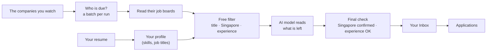
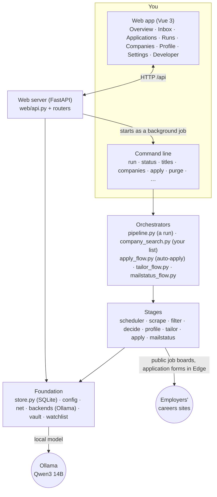

# JobScraper — overview

*How the app works, what it can do, and how the pieces fit together. Start here.
The specification for the resume tailor and auto-apply work is `docs/prd.md`
(M19–M22); the earlier milestones (M0–M17) are in
`.claude/prds/jobscraper-v2.prd.md`. This page is the short version.*

---

## In one minute

Looking for a job at specific companies means checking each company's careers
site again and again, and reading every posting to find the few that fit.
**JobScraper does that for you.**

You give it your resume and the companies you care about. It checks their
careers sites on a schedule, throws away everything that clearly doesn't fit,
asks an AI model to read what's left, and shows you a short list of
**new-graduate and early-career roles based in Singapore** that match you,
with the full job description and a place to track every application.

When you choose **Auto-apply** on a role, JobScraper applies for you: it fills
in the employer's application form in Microsoft Edge and submits it.

It runs on your own computer. The AI model runs locally too: no account, no
subscription, no API key.

---

## A week with JobScraper

1. **Open it** from the JobScraper icon on your desktop or taskbar. It opens in
   its own window, like any app. The **Overview** tab shows where you stand and
   what to do next.
2. **Start a run** from the Runs tab. Each run checks the companies that are due
   and adds any new matches to your Inbox.
3. **Go through the Inbox.** Each role shows the company, location, experience
   asked for, *why it matches you*, and the full job description.
4. **Act on each role:**
   - **Auto-apply**: adds the role to the auto-apply queue. JobScraper fills the
     form and submits it in the background. See "How applying works now" below.
   - **Apply on company site**: opens the posting in your normal browser.
     Afterwards the app asks "Did you apply at …?".
   - **Mark applied** or **Save**: the role moves to Applications.
   - **Not interested**: the role moves to a section at the bottom of the Inbox
     and stays there, even after you restart.
5. **Track your applications** in the Applications tab: Active, Applied,
   Interviewing, Offer or Rejected.
6. **Close the window** when you're done; the app shuts itself down.

Every company is checked again on a cycle you choose (weekly by default), so
the Inbox keeps filling with roles you haven't seen.

---

## How it finds your roles

In plain words:

| Step | What happens | Why it matters |
|---|---|---|
| **1. Your profile** | The AI model reads your resume once and pulls out your skills, the job titles that suit you and your experience. You can edit the titles and ask for suggestions. | Everything after this is matched against *you*, not a generic profile. |
| **2. Who is due** | The app keeps a queue of companies. Each run takes the ones that have waited longest, and each company is re-checked every 7 days by default (you can choose another cycle in Settings → Search). | Every company gets checked regularly without one huge, slow run. |
| **3. Read the job boards** | It reads each company's jobs straight from its hiring system (Greenhouse, Lever, Ashby, SmartRecruiters, Workable, Recruitee, Workday) or from its own careers page. | Postings come from the employer itself: no agencies, no copies from job boards. |
| **4. Free filter** | Simple rules drop what clearly doesn't fit: senior, lead and management titles (product, project and program manager roles are kept), internships, sales, marketing, recruiting, legal and HR roles, titles that match none of your job titles, anything not explicitly in Singapore (remote too), and roles asking for more than 3 years' experience. | This removes over 99% of postings at no cost, so the AI only reads the plausible ones. |
| **5. The AI reads** | A local AI model (Qwen3, run by Ollama on your computer) reads a short extract of each remaining posting and decides whether it fits you and the kinds of roles you are open to, why, whether it is in Singapore and how much experience it asks for. | It catches what simple rules can't: whether the work actually suits you. |
| **6. Final check** | Code, not the AI, makes the last call: a role is kept only if it is confirmed Singapore and within the experience limit. | The AI can't let a wrong location or a senior role slip through. |

Each answer is remembered, so a posting is never read or judged twice unless it
changes.

---

## How applying works now

Searching and applying are separate. A run only fills your Inbox. **Nothing is
ever applied to unless you click Auto-apply on that role.**

1. **Shortlist first.** Runs put new roles in the Inbox. You decide which ones
   are worth applying to.
2. **Click Auto-apply.** The role joins the **auto-apply queue** and leaves the
   Inbox at once. A message says "Applying now." or where it is in line
   ("Added to the auto-apply queue: 2nd in line."), with **See the queue** and
   **Undo**. You can keep going through the Inbox and add more roles while it
   works.
3. **It applies in the background, one role at a time.** For each role it
   prepares your resume, opens the employer's site in Edge, signs in or creates
   an account when the site needs one, fills the form and **submits it**.
   There is no second "are you sure?" step: your click is the go-ahead.
4. **It submits only when it is safe to.** Before it clicks Submit it checks the
   finished form. It stops that application, and sends nothing, when a required
   question has no answer it can back up, when a site shows a CAPTCHA or a bot
   check (it never solves one), or when it doesn't recognise a page. It never
   applies to the same posting twice.
5. **The role is marked Applied only when the employer's site confirms it.**
   Until then Applications shows it as **Queued · 1st**, **Applying…**, and so
   on.

**Where to watch it.** Runs → **Auto-apply queue** shows **Now applying** (the
role and the step it is on, such as "Filling the form"), **Up next** (the roles
waiting, in order) and **Recently finished** (the last 10, each with **Open in
Applications**). While it works, a pill at the top of the app says
"Auto-apply · 2 waiting". In Applications, each role shows its own state.

**How to pause it.**
- **Pause queue** stops after the application in progress. **Resume** carries on.
- **Stop this application** stops the one in progress and pauses the queue.
- **Remove** takes one waiting role out of the queue; **Clear queue** takes all
  of them out. Either way the roles stay in Applications as To apply.
- To have forms filled but **never** submitted, set Settings → Apply → **Mode**
  to **Dry run**. Roles already waiting are then filled only, too.
- The queue also pauses by itself when something needs you: the local AI model
  isn't answering, Edge couldn't open, two sites in a row showed a bot check,
  the same problem happened three times in a row, or today's limit is reached.
  A note in the queue panel says why and what to do; press **Resume** when it
  is fixed.

**After a restart.** If roles were still waiting when you closed JobScraper,
they are kept, but the queue does **not** start by itself. Runs shows "Roles
are waiting from your last session"; press **Resume** to continue, or clear the
queue.

**Limits.** By default there is **no daily limit** and at most **10
applications to one employer per day** (the day runs midnight to midnight,
Singapore time). Only real submissions count; dry runs don't. Change both in
Settings → Apply → Limits. A click past the employer limit is refused with the
reason.

**Searching while it applies.** The queue and a search run take turns. If you
start a run while an application is in progress, the button reads **Run after
this application**: the run starts when that application finishes, and the
queue carries on after the run.

**"Needs your input".** When an application stops because a form asked
something JobScraper had no answer for, nothing was sent. The row in
Applications says **Needs your answers** with **Answer in Profile** (its attempt
list says **Needs your input**). The question waits in Profile → Application
details → **Questions from applications**. Answer it once and it is used on
every application that asks. Then press **Retry** there (in Automatic submit
mode it first asks "Send … now?") or **Try again** on the row: the role goes
back into the queue. The queue doesn't wait for you; it goes on with the next
role.

**What the AI may read.** The local model reads your whole applicant profile and
your resume to fill a form, because it runs on your computer. Passwords and
other secrets are never put in a prompt. Code still makes the answers that
matter. For example, "Have you worked for us before?" is answered Yes only when
the company matches one of your past employers, by that employer's name or by
any of its other names. Two names match when they are the same, or differ only
by generic words such as legal forms ("Inc", "Pte Ltd"), places ("Singapore"),
"Group", "Holdings" or "Bank". Any other extra word means a different company.
You add an employer's other names in Profile → Application details →
Experience, in the **Also known as** field on each entry: the group or parent
company, a trading name or an abbreviation. Say you worked at "Northwind
Platforms Inc" and gave it the other name "Northwind". A posting from
"Northwind" or "Northwind Pte Ltd" gets Yes. One from "Northwind Logistics" gets
No. Without that other name, "Northwind" alone would not match either, because
"Platforms" is not a generic word.

**In progress, off by default.** A new way of filling is being built and
tested: the AI model fills every field, and any answer it had to assume would
be shown to you afterwards to keep or change. It is not switched on. Today's
filler still stops an application when a required question has no answer it can
back up.

---

## The app, tab by tab

### Overview: where your search stands
- Four number cards: **New roles** (in your Inbox), **Active applications**
  (not rejected or withdrawn), **Interviews**, and **Response rate** (an
  interview, offer or rejection after you applied counts as a reply). The first
  three open the matching list.
- **To do**: what needs you now, such as questions waiting for your answer,
  new roles to triage, and applications to follow up (applied 14 or more days
  ago with no reply). Each has a button that takes you there.
- **Pipeline**: a bar of Applied, Interviewing, Offer and Rejected. Click a part
  to open that stage in Applications.
- **Last run** (how it went, what it found) and **Past 7 days** (new roles
  found, to apply, applied, other updates).

### Inbox: new roles to go through
- A list on the left, the selected role in full on the right (one at a time on a phone).
- **Why it matches**, the experience asked for, where it is, when it was found.
- **About the job**: the full description as the employer wrote it, with Show more.
- **Auto-apply**, **Apply on company site**, **Mark applied**, **Save**,
  **Not interested**, each with an Undo. Auto-apply is greyed out until your
  application details are complete ("Finish your application details first").
- **Not interested** roles collect in their own section at the bottom, which you
  can fold away; "Move back to new roles" undoes it.
- Search, sort and choose which runs to show.
- A role you already track is never shown again as new, including the same
  posting listed under a second company name.

### Applications: everything you've acted on
- Tabs across the top: **All**, **Active**, **Applied**, **Interviewing**,
  **Offer**, **Rejected**, each with a count. Active holds everything still in
  play, including roles you saved and roles in the auto-apply queue. An
  assessment shows under Interviewing and a withdrawn application under
  Rejected, each with its own label.
- Sort **By company** or **Recent**; search; pick runs.
- One line per role. Its status pill opens **Move to** (Applied, Interviewing,
  Offer, Rejected). With a mouse you can also drag a role onto a tab. Every
  change is kept in the role's History and can be undone.
- Auto-apply states show on the line: **Queued · 1st**, **Applying…** (with the
  step), **Applied automatically**, **Needs your answers**, **Stopped: …** (with
  **Open the posting**), and **Try again** where it can go again. A role being
  applied to stays at the top and can't be moved until it finishes.
- The **⋯** menu: Add note, Show details (the job and its **Auto-apply
  attempts**), Open the posting, Remove from Applications.
- **From your email**: suggestions from your mailbox, if you connected one.

### Runs: searching, and the auto-apply queue
- **Auto-apply queue**: now applying, up next, recently finished, with
  **Pause queue**, **Resume**, **Clear queue**, **Remove** and **Stop this
  application** (see "How applying works now").
- **Start a run**: pick how many companies (30, 50, 100, 200, All or Custom);
  the button carries the number ("Check 100 companies"). The **Dry run** switch
  fetches and reports but saves nothing.
- **Run history**: date, companies checked, postings read, matches, time taken,
  failures, status. Tick runs and press **Show in Inbox** to see just their roles.

### Companies: the employers you watch
- One line at the top tells the story: how many are in your list, how many are
  watched, how many can be read, and how many were checked this cycle.
- A coloured bar below it; its legend is also the filter: **Checked this
  cycle**, **Due for a check**, **Failed**, **No job board found**, and others
  when they apply.
- One table you can sort: company, job board, open roles, last checked, status,
  and a link to the careers page.
- **Edit list** or **Upload list** (a text or Word file, one company per line,
  most wanted first); **Search now** finds each new company's careers site (the
  AI suggests it, the app proves there is a real job board behind it). **More**
  has the downloads and the full report.

### Profile: you, as the app sees you
- Two views: **Resume and titles**, and **Application details**.
- **From your resume**: what the app read (experience, graduation, a summary),
  with **Replace resume** (PDF or Word) and **Re-read resume**.
- **Skills** as chips, and **Job titles to search for**, which you can add to or
  remove; **Recommend titles** suggests new ones, never one it suggested before.
- **Application details**: the answers application forms ask for (contact
  details, work rights, declarations and so on), and **Questions from
  applications**: questions employers asked that JobScraper couldn't answer.

### Settings: one page, four parts
A list on the left picks the part. Each row shows its current value; change it
in place and it saves at once ("Saved"). Switching Mode to Automatic submit
asks you once ("Switch to automatic submit" or "Keep dry run").
- **Accounts**: your connected accounts: **Email updates** (Gmail), the
  **Application mailbox** (for the codes some sites email during an
  application), the **Apply browser**, the **Local AI**, and **Employer
  accounts**.
- **Apply**: **Mode** (Automatic submit or Dry run), **Show the browser
  window**, **Human-check wait** (how long to leave a CAPTCHA'd page open for
  you; it never solves one), **Applications a day**, **Per employer**, **Write
  cover letters** (off by default: you're asked instead), plus links to your
  application details and resume.
- **Search**: the cycle, companies per run, and links to job titles and companies.
- **Preferences**: colour theme, compact company list, keyboard shortcuts.

What you set in Settings is saved in the app and wins over `config/config.yaml`.
While Mode is Automatic submit, an **Auto-apply on** chip shows at the top of the
app.

**Application updates from email.** If you choose, the app reads your Gmail and
updates your applications when employers write: received, assessment, interview,
offer or rejection. You connect a mailbox in Settings → Accounts → Email
updates with a Gmail app password (or reuse the application mailbox) and tick
the consent box; the password is kept in Windows Credential Manager. While the
app is open it checks at start-up and every 10 minutes, or when you click
**Check now**. It only reads: it never marks mail as read, moves, deletes or
sends anything, and never opens a link. It checks the sender first and reads an
email only if it comes from a hiring platform or an employer you track (or
continues a thread it already matched). When it is sure, it moves the
application forward on its own; when it isn't, it leaves a suggestion under
**From your email** in Applications. Every change shows in the application's
history with a **From email** badge: open it to see the line from the email it
came from, then **Open in Gmail** or **Undo**.

### Developer
- The background job's live log, and Cancel: for when you want to see exactly
  what a run or an application is doing.

---

## What stays on your computer

- **Your data stays local.** The resume, your profile, every application and its
  history are stored on your computer only. The project's code is public; your
  data is never in it. The only things that leave are what an application sends
  to that employer, after you clicked Auto-apply on it.
- **The AI runs locally.** The model runs on your own computer through Ollama:
  no cloud AI service, no key, no cost per use.
- **Searching reads public pages only, politely.** It reads employers' public job
  listings, waits between requests, respects sites that ask not to be crawled,
  and never logs in while searching. It does not scrape LinkedIn.
- **Applying uses accounts only when a site needs one.** During an application
  you started, JobScraper signs in to the employer's application site or creates
  an account there. Passwords are kept in Windows Credential Manager, never in
  the database or a log.
- **Email is read, never changed.** If you connect Gmail, the app reads it
  read-only, keeps no email bodies or links, and writes nothing about your mail
  to its logs.
- **It tidies up after itself.** Job descriptions you'll never look at are
  deleted after 7 days to keep the database small; descriptions of roles in your
  Inbox or Applications are kept.

---

## How to open and use it

| You want to | Do this |
|---|---|
| Open the app | Click the **JobScraper** icon (desktop, Start menu or taskbar). Close its window to stop it. |
| Check for new roles | Runs tab → Start a run, then the Inbox. |
| Apply to a role | Inbox → the role → **Auto-apply**. Watch it in Runs → Auto-apply queue. |
| Pause applying | Runs → Auto-apply queue → **Pause queue** (or **Stop this application**). |
| Fill forms without sending | Settings → Apply → Mode → **Dry run**. |
| Change the limits | Settings → Apply → Limits. |
| Answer a form's question | Profile → Application details → Questions from applications. |
| Add companies | Companies tab → Edit list or Upload list, or edit `config/watchlist.yaml`. |
| Update your resume | Profile tab → Replace resume. |
| See exactly what was sent | `python -m jobscraper apply show <job id>` prints one attempt's answers. |
| Use the command line | `python -m jobscraper <command>` with `PYTHONPATH=src`; see the README's command table. |

Setting it up on a new computer is in the [README](../README.md).

---

## How the pieces link together

*For readers who want the technical picture.*

- **One process, two faces.** `python -m jobscraper web` serves both the web app
  (built files committed under `src/jobscraper/web/static/`) and its API under
  `/api`. The desktop icon starts it hidden and opens it in its own window.
- **The web server never does slow work itself.** A run, a profile refresh, title
  recommendations, a company search or the auto-apply worker is started as a
  background job (the same CLI command), one at a time; the web app follows it
  and the Developer tab shows its log.
- **The auto-apply queue is a table, the worker is a job.** A click only records
  the role in the queue. When the one job slot is free, the web app starts the
  worker (`jobscraper apply queue`), which applies to the waiting roles one by
  one and exits. Only the live app starts the worker: a development copy (a
  copied database, another port or config, or code from a git worktree, or
  `JOBSCRAPER_APPLY_QUEUE=0`) records clicks but never applies.
- **Clear layers.** Orchestrators wire the stages together; stages never call
  each other; `store.py` is the only code that talks to the database;
  `backends.py` is the only code that talks to the model. A test
  (`tests/test_layering.py`) enforces this.
- **Everything is remembered by content.** Filter verdicts are keyed by the rules
  and your job titles; AI decisions by your profile version and the posting's
  extract. Changing a rule re-checks postings for free; nothing is judged twice.
- **Files you own vs files it owns.** You edit `config/watchlist.yaml`,
  `config/rules.yaml`, `config/config.yaml` and your resume; the app owns
  `data/jobscraper.db` (your history: back it up), `data/shortlist.json` and
  `data/profile.derived.yaml`.
- **Tested.** About 1,800 Python tests and 1,000 web-app tests
  (`python tests/run_tests.py`, `cd web; npx vitest run`).

---

## Where to read more

| Document | What's in it |
|---|---|
| [README](../README.md) | Setup, commands, configuration. |
| [docs/DESIGN.md](DESIGN.md) | The architecture diagrams and the decisions behind them. |
| [docs/prd.md](prd.md) | The specification for M19–M22: the cloud port, the resume tailor and auto-apply. |
| `docs/architecture/apply_queue_design.md` | How the auto-apply queue works. |
| `.claude/prds/jobscraper-v2.prd.md` | The specification and build record of the earlier milestones (M0–M17). |
| `jobscraper-cloud` repository | The plan for a hosted, multi-user version of JobScraper. |
