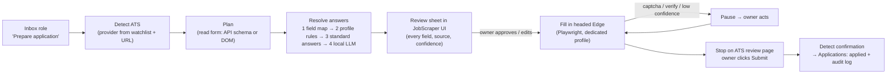

# Auto-apply: research brief

*Status: research only. Nothing is built. Written 2026-11-01. No accounts were
created, no forms submitted and no sites logged in to while this was researched.*

**How to read this brief.** Every external claim cites a source `[Sn]` from the
source list at the end, with the date it was checked (all 2026-11-01) and how it
was checked: the page itself, a search-result snippet, or the GitHub API. Claims
are marked:

- **F** (fact): a source states it.
- **I** (inference): my reasoning from facts. It may be wrong.
- **O** (opinion): a judgement or recommendation.
- **K** (prior knowledge, not re-checked this session): believed true, but
  listed again under *Unverified items*.

**Context that shapes everything below (F, [S39]).** `config/watchlist.yaml`
holds 329 companies. By provider: custom careers page 100, **Workday 87**,
**Greenhouse 75**, Ashby 19, Lever 17, Workable 13, SmartRecruiters 13,
Recruitee 4. The 100 custom pages are vanity sites for banks and big tech
(Goldman Sachs, HSBC, UBS, Maybank and others) and usually front an enterprise ATS
(Workday, SuccessFactors, Oracle, Eightfold, Phenom). So about half the value
is in Workday plus those enterprise systems, and they are the hardest targets.

**Repo status (F, owner memory).** The personal JobScraper is marked *frozen* on
branch `personal`, and multi-user work goes to `JobScraper-Cloud`. Where this
feature lives is the first decision for the owner (see *Decisions*).

---

## 1. Prior art

### 1.1 Summary table

| Tool | Type / licence | Activity (GitHub API, 2026-11-01) | Approach | Verdict |
|---|---|---|---|---|
| **AIHawk** (`feder-cr/Jobs_Applier_AI_Agent_AIHawk`) | Open source. Forks carry AGPL-3.0 [S3]; the repo the URL now points to is MIT [S1] | **The URL now redirects to `feder-cr/invisible_dots`**, an unrelated "undetectable by anti-bot systems" browser agent, with 32,336 stars inherited from the old repo [S1]. A third-party snapshot shows the last AIHawk-era push as 2025-05-28 [S2] | K: Python + Selenium, LinkedIn Easy Apply only, a cloud LLM (OpenAI etc.) answers free-text questions and makes a tailored resume | **Reject** the code. **Learn from** its question-answer prompting only |
| **Simplify Copilot** | Closed source, free browser extension (Chrome; Firefox in beta) [S4][S7] | n/a | The extension detects a supported form and matches fields from your Simplify profile, which is stored in Simplify's cloud [S4]. Claims 100+ portals [S5]. A competitor's review puts accuracy at 85–90% on Greenhouse, Lever and Ashby and about 70% on Workday [S6] (biased source) | **Learn from** the UX (in-page overlay, fill then you review). **Reject** reuse: closed, cloud profile |
| **LazyApply** | Closed source, paid extension | n/a | K: mass-applies through LinkedIn, Indeed and ZipRecruiter "Easy Apply" | **Reject.** Cautionary tale: Trustpilot 2.5 from 107 reviews [S8]; complaints about applying to irrelevant roles, wrong form answers and refunds [S9] |
| **Jobright Agent / autopilot** | Closed SaaS | n/a | You pick the jobs; the agent works through the applications after you start it; plan-gated limits [S10]. Third parties say it covers Workday, Greenhouse, Lever, Taleo and iCIMS [S10 snippet] | **Learn from** its failure modes. Reviews call auto-apply unreliable and report **hallucinated metrics submitted without review** [S11] |
| **Sonara** | Closed SaaS | Defunct | The original company **shut down on 2024-02-01** for lack of funding, and users lost their data. Claims of a relaunch under BOLD are disputed [S12] | **Reject.** Lesson: SaaS dependency and data loss. Local-first is right |
| **career-ops** (`career-ops-hq/career-ops`, formerly `santifer/career-ops`) | MIT | **79,194 stars**, pushed 2026-11-01 [S13] | Node. **Launches its own Playwright Chromium**, "does not attach to your ordinary system browser or a remote-debugging port". Field-tested on Ashby, Greenhouse, Lever and Workable. **Never submits** [S13] | **Learn from, heavily**: best documentation of per-ATS quirks. Not drop-in (Node, cloud-LLM agent) |
| **job-apply-plugin** (`neonwatty/job-apply-plugin`) | MIT | 132 stars, pushed 2026-10-21 [S14] | A Claude Code or Codex plugin. Drives the **user's real Chrome** through Claude in Chrome. Covers LinkedIn, Greenhouse, Ashby, Lever, Rippling and Workday ("current forms unverified"). Stops at final review [S14] | **Learn from** its answer-memory model, which is the closest design to ours. **Reject** reuse: it needs a cloud agent |
| **Job App Filler** (`berellevy/job_app_filler`) | BSD-3-Clause | 29 stars, last push 2025-02-11 [S15] | MV3 Chrome extension for Workday and iCIMS. A content script plus an injected page script fill React-controlled fields; saved answers per field; data stays local [S15] | **Adapt / learn from** the Workday field-filling technique. The BSD licence allows reuse with attribution |
| **Workday-Application-Automator** (`ubangura/...`) | **No licence**, so all rights reserved | 77 stars; README says superseded by a commercial extension [S16] | Node + Puppeteer, fixed data file, Workday only | **Learn from only.** Its code can't be reused legally |

Also seen: dozens of low-star LinkedIn "Easy Apply" bots and abandoned forks
(gh search, 2026-11-01). None targets Singapore forms or a local LLM.

### 1.2 What the prior art teaches (by question)

**Extension, Playwright or CDP.**
- F: career-ops uses a separately launched Playwright Chromium [S13].
- F: job-apply-plugin and Simplify act inside the user's real browser (extension or agent) [S4][S14].
- F: Job App Filler shows that filling React-controlled inputs from an extension needs a script injected into the page, not just a content script [S15].
- I: no mature open-source tool attaches to the user's *default* profile over a remote-debugging port. That matches the Chromium change in §3.

**Field mapping.**
- F: career-ops keeps per-ATS rules plus an LLM drafting answers [S13].
- F: job-apply-plugin keeps "confirmed / inferred / missing / sensitive" answer states with provenance, and a **separate consent to remember** a sensitive answer [S14].
- F: Simplify matches fields against a structured profile [S4].
- O: every serious tool ends up with per-ATS adapters for structure and a model only for the unknown questions.

**Per-ATS quirks worth copying (F, [S13]):**
- **Lever** may show an **hCaptcha when checkboxes or radios are clicked programmatically**. career-ops fills only text fields and selects there, and leaves checkboxes, radios and the captcha to the human.
- **Workable** is a single-page app that re-renders, so stored element references go stale. career-ops re-queries before every action and falls back to clipboard paste.
- **react-select dropdowns** (Greenhouse, Ashby, Lever) rebuild their DOM on each keystroke. Type with short delays and re-snapshot.
- **Ashby** merges candidates by email. Applying twice to one company can merge or overwrite a profile.
- **Knock-out pre-scan:** before filling, check sponsorship, years-of-experience and degree questions and warn the user.

**Accounts, passwords, email verification.**
- F: none of the open-source tools found automates account creation or email verification.
- F: the Workday automator's README names "need to create an account for each company" as the main pain [S16].
- I: commercial tools that claim Workday coverage either have the user create the account or do it inside their own cloud browser. None documents how. Treat this as **unsolved prior art**.

**CAPTCHAs.**
- F: career-ops and job-apply-plugin hand the captcha to the human [S13][S14].
- F: the AIHawk URL now hosts a project marketed as "undetectable by anti-bot systems" [S1].
- O: that is the opposite of what we want.

**Review before submit.**
- F: both well-maintained open-source tools refuse to submit: "You press Submit" [S13], "Stops at final review" [S14].
- F: the reported failures of the closed auto-submitters are wrong answers and invented metrics [S9][S11].

**Failure rates.**
- F: the only number found is the competitor-sourced 70% (Workday) to 90% (Greenhouse and peers) field accuracy for Simplify [S6].
- I: an unattended run that touches 30 fields at 90% accuracy each will almost always contain at least one wrong answer (0.9^30 ≈ 4% chance that all 30 are right). That is the quantitative case for review before submit.

---

## 2. Per-ATS application flow

### 2.1 Per-ATS table

| ATS | Account needed? | Single page or wizard | Resume parse and prefill | Structure stability | Official application API usable by us? | CAPTCHA / bot check | Email verification |
|---|---|---|---|---|---|---|---|
| **Greenhouse** | No. An optional candidate account (MyGreenhouse) exists [S19] | Single page (K) | K: optional "autofill from resume" on newer boards; unverified | **High.** The public Job Board API returns the full question schema with `?questions=true`: field `name`, `type` (`input_text`, `textarea`, `input_file`, `input_hidden`, `multi_value_single_select`, `multi_value_multi_select`), `required`, plus `compliance` (EEOC), `demographic_questions`, `location_questions` and `data_compliance` (GDPR consent) [S17] | **No.** The application POST needs the employer's Basic-Auth key, and Greenhouse says form posts "should be proxied by your own servers" [S17] | **Google reCAPTCHA**, usually invisible. Depending on the board's spam setting and the score, the applicant may get a visible challenge or be asked for an emailed code. The sensitivity is set per board [S18] | Sometimes: an emailed code when reCAPTCHA is unsure [S18] |
| **Lever** | No (K) | Single page (K) | K: resume upload prefills name and contact; unverified | Medium-high. Stable `name` attributes, custom "cards" (K) | K: the Postings API apply endpoint needs the employer's API key, so no | **hCaptcha** for suspicious users [S20]. Triggered by programmatic checkbox and radio clicks [S13] | Not seen |
| **Ashby** | No (K) | Single page (K) | K: "autofill from resume"; unverified | Medium-high. React form; react-select [S13] | K: posting API is read-only for us; application POST needs a key | **Application spam protection**, level set by the employer, "no protection" is an option [S21]; mechanism undocumented | Not seen. Merges candidates by email [S13] |
| **Workable** | No (K) | Single page (K) | K: yes | **Medium-low.** The SPA re-renders and references go stale [S13] | K: no public candidate API | Unknown | Not seen |
| **Recruitee** | No (K) | Single page (K) | Unknown | Medium (K) | No (K) | **Optional captcha** the employer can switch on [S22] | Not seen |
| **SmartRecruiters** | Usually no; "apply without account" is claimed only in partner marketing [S26] | Short wizard (K) | K: resume parse, plus LinkedIn/Indeed import | Medium (K) | K: the Application API is for partners and needs a key | Unknown | Unknown |
| **Workday** | **Yes, one account per employer tenant**. The login does not carry across companies [S23] | **Multi-step wizard** (K: My Information, My Experience, Application Questions, Voluntary Disclosures, Self-Identify, Review) | **Yes, often wrong.** Users must re-enter fields after upload [S23] | **High for selectors.** K: `data-automation-id` attributes are stable across tenants and are what Job App Filler and Simplify use. **Low for content**: each tenant adds its own questions | No | Unknown. K: some tenants show none | **Some tenants**: Workday can send a candidate verification email when no home account is required [S23] |
| **SAP SuccessFactors** | Usually yes, at least for one documented employer [S26] | Wizard (K) | K: yes, through the profile import | Low-medium. Configured heavily per employer (K) | No | Unknown | K: often, on account creation |
| **Oracle Recruiting Cloud (ORC)** | K: no password; email plus one-time PIN | Wizard (K) | K: yes | Medium (K) | No | Unknown | **K: one-time PIN by email for every apply** |
| **Oracle Taleo** | **Yes.** Oracle documents a separate candidate account for applying through a career section [S25] | Long wizard (K) | K: weak | Low. Legacy markup (K) | No | Unknown | K: sometimes |
| **iCIMS** | Yes. A login made with that company, or social sign-in (Google, Microsoft, LinkedIn, Facebook) where the employer allows it [S24] | Wizard (K) | K: yes | Low-medium. Some forms sit in iframes (K) | No | K: some portals; unverified | K: sometimes |

### 2.2 Ranking by expected automation success

O, based on the table above and the quirks from [S13]:

1. **Greenhouse**
   - Why first: no account, one page, and a **public machine-readable question schema** [S17]. The whole answer plan can be built *before* a browser opens.
   - Risk: reCAPTCHA may escalate to a challenge or an email code [S18]. Both go to the human.
2. **Lever**
   - Why: no account, one page.
   - Risk: hCaptcha when checkboxes are clicked [S13][S20]. So the human ticks the boxes.
3. **Ashby**
   - Why: no account, one page.
   - Risk: employer-tunable bot detection, plus duplicate merge by email [S13][S21].
4. **Recruitee**: simple form; optional captcha [S22]; only 4 watched companies.
5. **Workable**: simple but fragile DOM [S13].
6. **SmartRecruiters**: short wizard; sparse evidence.
7. **Workday**
   - For: biggest share (87 companies) and stable selectors (K).
   - Against: per-tenant account, email verification on some tenants, a multi-step wizard, tenant-specific questions [S23], and terms of service that are hostile to third-party apps (§7).
8. **Oracle ORC**: the PIN step makes email handling mandatory.
9. **SuccessFactors**: account plus heavy per-employer configuration.
10. **iCIMS**: account, iframes.
11. **Taleo**: account, long legacy wizard.

---

## 3. Browser control on Windows, aimed at the owner's real Edge

### 3.1 Facts

- **F [S27]** (Chrome blog, 2025-03-17): from **Chrome 136**, `--remote-debugging-port` and `--remote-debugging-pipe` "will no longer be respected if attempting to debug the default Chrome data directory". They work only with a non-default `--user-data-dir`, which uses a different encryption key. The stated motive is cookie theft. For automation, Google recommends a custom user-data-dir or Chrome for Testing.
- **F [S28]** (Playwright docs): "Due to recent Chrome policy changes, automating the default Chrome user profile is not supported". Pointing at it "may result in pages not loading or the browser exiting". Use a separate directory instead.
- **F [S28]**: Playwright supports branded Edge through `channel: "msedge"`.
- **F [S28]**: `connectOverCDP` is "significantly lower fidelity than the Playwright protocol connection".
- **F [S28]**: two browser instances cannot share one user-data-dir.
- **Edge.** No source found states that Edge 136+ applies the same block [S38 search]. I: Edge inherits Chromium's code, and Microsoft already adopted the related hardening (app-bound encryption, Edge 127+ [S30]). So **assume Edge blocks it too**, until a 2-minute local test proves otherwise (see *Unverified items*).

### 3.2 Options

| Option | Saved passwords and autofill in the owner's Default profile? | Fit with stack | Robustness | Bot-signal risk | Build cost |
|---|---|---|---|---|---|
| **A. Playwright (Python), `channel="msedge"`, headed, persistent context on a *dedicated* user-data-dir** (e.g. `%LOCALAPPDATA%\JobScraper\edge-apply`) | **No.** Saved passwords land in the dedicated profile, not Default. Bridge with §4 | Excellent: Python, same process model as runs | High: full Playwright API, file upload, waits | I: `navigator.webdriver` is set, which may lower reCAPTCHA scores and cause more challenges for the human | Low-medium |
| **B. CDP attach to the running Default Edge** (`--remote-debugging-port`) | Would be yes | Good | **Blocked** on the default profile in Chromium 136+ [S27]; would need a non-default dir, which turns it into option A | n/a | n/a |
| **C. Browser extension (MV3) in the owner's Default Edge profile**, talking to the local FastAPI app on `127.0.0.1` | **Yes.** Real profile, so Edge's own "Save password?" prompt and autofill work as normal | New code base (TypeScript, MV3); Edge requires sideloading in developer mode or publishing to the Edge Add-ons store | Medium: page-injected scripts for React inputs [S15]; resume upload through a `DataTransfer` file built from bytes the extension fetches from the local API (K) | Lowest: a real user session, no webdriver flag | High |
| **D. Extension that uses the `chrome.debugger` API** (CDP inside the real profile, no port) | Yes | As C | High: trusted input events and `DOM.setFileInputFiles` (K) | Edge shows an "is being debugged" banner (K) | High |

### 3.3 Recommendation (O)

- **Walking skeleton: option A.**
  - It is the only route that stays in Python, keeps the app's layering, and is proven by career-ops [S13].
  - Run Edge **headed**, at human pace, one application at a time, in a profile JobScraper owns.
  - The owner watches it and takes over for captchas, verification and Submit.
- **Revisit option C after two ATSs work**, if keeping passwords in the Default profile matters more than build cost.
  - C is the *only* route that honours "saved passwords and autofill live in my normal browser" without import steps.
  - It is a second code base to maintain.
- **Reject B.** It is closed on the default profile [S27], and the Playwright docs warn against it [S28].
- I: a middle path may work. Sign the dedicated profile (A) into the owner's Microsoft account with password sync on, so saved passwords flow to Default through Edge sync. Unverified: Playwright's default flags may disable sync, and the owner would have to sign in by hand (we never log in for them).

---

## 4. Storing passwords "in the default browser"

### 4.1 What is possible

| Route | Works? | Notes |
|---|---|---|
| **Edge CSV import** (Settings → Passwords → Import, "Passwords CSV file") | **Yes, officially** [S29] | A manual, owner-initiated UI step. There is no documented API for a third-party app (I). The CSV is plaintext, so delete it straight after import [S29 snippet]. K: Chromium columns are `name,url,username,password`; check against an Edge export first |
| **Edge's own "Save password?" prompt in a real Edge window** | **Yes.** It is the normal path | The password saves to *whichever profile the window belongs to*. With option A that is the dedicated profile; with option C, Default. K/unverified: whether Edge offers to save when a script, not the keyboard, filled the field |
| **Write Edge's `Login Data` SQLite directly** | **Reject** | Edge 127+ binds local-storage encryption keys to Edge itself (app-bound encryption) where possible, and Microsoft says disabling it hurts security [S30]. Getting around it is the technique infostealers use [S31]. It is fragile, unsupported, and likely to trip antivirus (I) |
| **Windows Credential Manager through Python `keyring`** | **Yes** | K: `keyring` uses the Windows Credential Locker backend on Windows. Encrypted per Windows user, visible in Control Panel → Credential Manager, scriptable and supported |

### 4.2 Recommendation (O)

- **Primary: Windows Credential Manager (`keyring`) as JobScraper's own vault.**
  - Store one entry per tenant, e.g. service `jobscraper:workday:<tenant-host>`, user = email.
  - Use a generator built on `secrets` (20+ characters, mixed classes, rules adjusted per ATS).
  - The SQLite DB stores only *that an account exists* (tenant, email, created_at, verified?), **never the password**.
- **Into Edge, two ways:**
  - (a) When the run happens in a real Edge window, let Edge's Save prompt fire and the owner clicks Save.
  - (b) A **"Export new passwords for Edge"** button writes a CSV of accounts created since the last export. The owner imports it through Settings → Passwords, and the app deletes the file. Best-effort overwrite and delete; warn that SSD wear-levelling means "secure delete" is not guaranteed.
- **Fallback:** if CSV import is ever removed from Edge, the vault is still the source of truth, and the app shows the password for a one-click copy.

---

## 5. Email verification links

| Option | How | Security trade-off | Fit |
|---|---|---|---|
| **1. The owner clicks the link** | The run pauses with "Check your inbox for <tenant> and click Verify", then polls the page until it moves on | **None added.** No mail credentials leave the owner's control | **Best for v1.** Verification happens only at account creation (Workday, SuccessFactors, iCIMS, Taleo) or when Greenhouse's reCAPTCHA is unsure [S18][S23] |
| **2. IMAP with a Gmail app password** | `imaplib` over TLS. Search by sender and time window; extract the link or PIN; open it in the same browser | An app password is a **full-mailbox credential** that skips 2-Step Verification. It needs 2SV on, isn't offered with Advanced Protection or security-key-only 2SV, and is revoked when the account password changes [S34]. Store it in Credential Manager; read only; match strict sender domains | Good for Oracle ORC PINs, if many ORC employers are targeted |
| **3. Gmail API (OAuth, `gmail.readonly`)** | Google Cloud project, desktop OAuth client, token in Credential Manager | Narrower than IMAP (read-only, revocable per app). K/unverified: `gmail.readonly` is a *restricted* scope; an unverified "testing" app works for the owner alone, but refresh tokens may expire every 7 days | Over-engineered for one user |

**Recommendation (O):** option 1 now. Option 2 later, behind an explicit opt-in.

Also:
- **Plus-addressing** (`owner+<company>@gmail.com`, K) makes mail filters and duplicate checks easy.
- Mind Ashby's merge-by-email behaviour [S13]: decide per ATS whether to use the base address or a plus-address, and keep it the same for each employer.

---

## 6. Singapore-specific questions, and a profile schema

### 6.1 What the rules say

- **NRIC (F, [S32]).** PDPC's NRIC Advisory Guidelines (issued 2018-08-31, in force 2019-09-01) say organisations should not collect, use or disclose NRIC numbers, or FIN, work-permit and birth-certificate numbers, **unless required by law or necessary to accurately establish or verify identity**. Penalties under the PDPA reach S$1 million.
  - I: a request for the full NRIC on a first-round application form is usually hard to justify. Background screening at offer stage is the usual justified case.
  - O: the profile should **not store a full NRIC**. If a form makes it mandatory, pause and let the owner type it.
- **Fair forms (F, [S33]).** TAFEP's guidance for employers says application forms should collect only information related to the job. Its checklist removes fields on age, gender, race, religion, marital status, family responsibilities and disability, nationality-related items such as **NS liability**, and mental-health declarations.
  - F [S33]: the **Workplace Fairness Act** takes effect at the end of 2027 (per TAFEP); until then the Tripartite Guidelines apply, enforced through work-pass sanctions.
  - I: many Singapore forms, especially at banks on Workday or SuccessFactors, **still ask** race, NS status and date of birth. The profile must hold them, and the owner may choose "prefer not to say" where offered.
- **Global ATS questions (F, [S17]).** Greenhouse exposes US EEOC `compliance` questions and `demographic_questions` as separate blocks. K: Workday's "Voluntary Disclosures" and "Self-Identify" steps ask US-style gender, ethnicity, veteran status and disability (Form CC-305) even on Singapore jobs at US-headquartered firms.
  - O: default these to the "decline to self-identify" option where one exists.

### 6.2 Proposed applicant profile schema (O)

Stored in `config/applicant.yaml`, which the owner edits like the other config files. Sensitive fields are marked **S**: they are always shown in the pre-submit review, never sent to any LLM prompt beyond a field label, and excluded from logs.

| Group | Field | Type | Notes |
|---|---|---|---|
| Identity | `legal_first_name`, `legal_last_name`, `preferred_name`, `name_order` | str, str, str, enum(`western`,`surname_first`) | Singapore names often need "surname first" |
| | `pronouns` | str? | Optional |
| | `date_of_birth` **S** | date? | Fill only if required |
| | `gender` **S** | enum(`male`,`female`,`non_binary`,`decline`) | |
| Contact | `email` (base), `email_strategy` | str, enum(`base`,`plus_per_company`) | §5 |
| | `phone_country_code`, `phone_number` | str, str | `+65` |
| | `address_line1/2`, `postal_code`, `city`, `country` | str | SG postal code is 6 digits |
| Singapore status | `nationality` | ISO country | |
| | `residency_status` **S** | enum(`citizen`,`pr`,`foreigner`) | |
| | `work_pass` | enum(`none_required`,`ep`,`s_pass`,`dp`,`ltvp_loc`,`student_pass`,`other`) | |
| | `requires_sponsorship` | map[country → bool] | e.g. `SG: false`, `US: true` |
| | `authorised_to_work` | map[country → bool] | |
| | `ns_status` **S** | enum(`completed`,`serving`,`exempted`,`not_applicable`), plus `ord_date` date? | |
| | `race` **S** | enum(`chinese`,`malay`,`indian`,`eurasian`,`other`,`decline`) plus `race_other` str | CMIO plus Other |
| | `religion` **S** | str? | Rare; default `decline` |
| | `nric` **S** | **not stored**; `nric_last4` optional | §6.1 |
| | `marital_status` **S** | enum? | Rare; default `decline` |
| US-style self-ID | `eeo_gender`, `eeo_race_ethnicity`, `veteran_status`, `disability_status` **S** | enum, each with `decline` | Default `decline` |
| Availability | `notice_period_days` | int | 0 for a new grad |
| | `earliest_start_date` | date | |
| | `willing_to_relocate`, `willing_to_travel_pct` | bool, int | |
| Pay | `expected_salary` | {amount:int, currency:`SGD`, period:enum(`monthly`,`annual`), negotiable:bool} | Singapore forms usually ask monthly; keep both, convert ×12 (or ×13 with AWS, per owner) |
| | `current_salary` | {amount, currency, period}? | New grad: 0 or "N/A" |
| Education | `education[]` | {institution, degree, major, minor?, start, end, grade_type:enum(`gpa`,`cap`,`honours_class`), grade, grade_scale} | e.g. NTU, B.Eng Computer Engineering |
| Experience | `experience[]` | {employer, title, start, end?, location, description} | Copied from the resume, then edited |
| Skills | `skills[]`, `languages[]` | str[], {language, spoken, written:enum} | |
| Links | `linkedin`, `github`, `portfolio`, `other_links[]` | url | |
| Documents | `resume_default_path`, `transcript_path?`, `cover_letter_template?` | path | Tailored resume per job: §8 |
| Sourcing | `how_heard_default` | str | e.g. "Company careers site" |
| | `referral` | {name, email}? | Per job |
| Consents | `privacy_consent`, `data_retention_consent`, `talent_pool_opt_in` | bool | Greenhouse `data_compliance` [S17] |

### 6.3 Standard answers for declarations (O)

The owner's standard answer is "no", but declarations are **attestations**: a wrong "no" can be grounds to rescind an offer. So each one is a rule with exceptions, not a blanket answer.

| Declaration type (classifier label) | Default | Auto-answer only if… | Otherwise |
|---|---|---|---|
| `pep` (politically exposed person, self or family) | No | always | |
| `conflict_audit_independence` (financial interest in or relationship with an audit client) | No | no shareholding exception below applies | Pause |
| `shareholding_in_company` | No | `profile.holdings` has no ticker or entity matching the employer | **Pause.** A direct brokerage holding in a listed employer (e.g. a bank) may make "yes" true |
| `relatives_at_company` | No | `profile.relatives_employers` doesn't include the employer | Pause |
| `prior_employment_at_company` | No | the employer is **not** in `experience[]` (internships count) | **Pause, or answer Yes** from the resume |
| `previously_applied` | from JobScraper's own Applications table | always (data-driven) | |
| `criminal_record`, `bankruptcy`, `regulatory_disciplinary` (MAS-type) | No | always, but **show in review** | |
| `non_compete_or_restrictive_covenant` | No | always, show in review | |
| `health_or_mental_health` | Leave blank or "prefer not to say" if possible | n/a (TAFEP says remove [S33]) | Pause if mandatory |
| Anything the classifier can't label confidently | n/a | never | Pause |

---

## 7. Terms of service, legal and ethical

**Facts.**
- **Workday.** Workday's site terms forbid developing or using applications that interact with its Sites without prior written consent, and forbid scrapers and robots [S35].
  - I: it is unclear whether those terms govern tenant career sites on `myworkdayjobs.com`, where the employer is the data controller.
  - F: at least one auto-apply vendor refuses Workday sites on these grounds [S35 search snippet].
- **Indeed** explicitly bans bots and automation of Indeed Apply [S36]. It is not a JobScraper target, but it shows the industry norm.
- **Greenhouse and Lever.** No candidate-facing terms about automation were found (gap).
  - F: their anti-spam controls are explicit: reCAPTCHA with employer-tuned sensitivity [S18], hCaptcha for suspicious users [S20], and Ashby's bot detection [S21].
  - F: Greenhouse's *official* programmatic route needs the employer's key [S17], so a candidate-side POST is impossible by design.
- Auto-apply vendors' own terms warn users that automated submission "may violate the terms of service of third-party job sites" [S37] (low-quality source, cited only for the industry stance).

**Risk of rate limits or bans (I).**
- The realistic penalty is not legal action against a single applicant. It is:
  - (a) silently dropped or spam-flagged applications;
  - (b) more captcha friction;
  - (c) duplicate or merged candidate records [S13];
  - (d) on Workday, a locked tenant account.
- Volume and identical timing patterns raise all four.
- At JobScraper's scale (a few hundred companies, a few new roles a week), staying human-paced is easy.

**CAPTCHAs go to the human (O, firm).**
- A CAPTCHA is the employer saying "a person must do this step". Solving services and stealth or anti-detection plugins defeat a control the site owner chose. That is deceptive, probably breaches the terms, and is out of scope.
- The app must detect a challenge iframe (reCAPTCHA, hCaptcha), stop all input, bring the window forward and wait.
- No fingerprint spoofing either. The contrast with the "undetectable by anti-bot systems" repo now at the AIHawk URL [S1] is deliberate.

**Final review before submit (O, firm for v1).**
1. Error compounding (§1.2): about 4% chance that 30 fields at 90% accuracy are all right.
2. Attestation risk: declarations and work-authorisation answers are legal statements (§6.3).
3. LLM invention: hallucinated metrics have been submitted without review [S11]; Qwen3-14B is smaller than the cloud models those tools used.
4. Captchas often appear *at* submit anyway [S18].
5. The two best-maintained open-source tools make it a hard rule [S13][S14].

**Data protection (I).** The applicant profile, the audit log and the vault hold the owner's own personal data on their own machine, so the PDPA's obligations on organisations don't apply to self-use. The real risk is leakage: logs, crash dumps, LLM prompts. Hence the **S** handling in §6.2.

---

## 8. Recommended architecture sketch (O)

### 8.1 Shape

- **Layering.** A new stage package `src/jobscraper/apply/` holds:
  - `detect.py`, `plan.py`, `resolve.py`, `browser.py`, `vault.py`;
  - `ats/greenhouse.py`, `ats/lever.py`, and so on.

  An orchestrator `apply_flow.py` wires them, like `pipeline.py`. `store.py` stays the only DB code: it gets new tables for `apply_plans`, `apply_answers` (audit) and `ats_accounts`. `backends.py` stays the only model code. `tests/test_layering.py` is extended.
- **Background job.** As with runs, `python -m jobscraper apply --job <id>` runs as the one background job. The web app follows its state machine: `planning → awaiting_review → filling → paused(reason) → awaiting_submit → submitted | abandoned`.

### 8.2 Adapter order

1. **Greenhouse.** This is the walking skeleton (below).
2. **Lever.**
3. **Ashby.**
4. **Workday.** Highest value, but it needs the vault, email pause and wizard driver first, and an owner decision on terms risk.
5. **Workable**, **SmartRecruiters**, **Recruitee.**
6. **Generic fallback** for custom pages, SuccessFactors, ORC, iCIMS and Taleo. LLM-assisted DOM labelling, *fill-only*, with every field confirmed. Many of the 100 custom pages will land here.

### 8.3 Answer resolution and the confidence threshold

| Tier | Source | Confidence | Auto-fill? |
|---|---|---|---|
| 1 | **Per-ATS field map** (e.g. Greenhouse `first_name`, `email`, `resume`; Workday `data-automation-id`, K) | 1.0 | Yes |
| 2 | **Profile rule** keyed by a normalised question label (regex or synonym table: "notice period", "expected monthly salary", "Singapore Citizen or PR") whose answer maps exactly onto an offered option | 0.95 | Yes |
| 3 | **Standard answer** (§6.3) whose rule and exceptions pass | 0.95 | Yes, but always listed in review |
| 4 | **Local LLM (Qwen3-14B through Ollama)** for unknown questions. Given the label, the option list and a *minimal* profile extract, choose an option index or say `UNKNOWN`. JSON-constrained output; run twice, at temperature 0 and at 0.7 | 0.9 if both runs agree and the choice is grounded in a profile field; 0.6 if they disagree; 0 for `UNKNOWN` | Only ≥ 0.9 **and** the field is not sensitive |
| 5 | **Free-text answers** ("Why us?", cover-letter boxes) | n/a | Never auto. Draft, then the owner edits |

- **Threshold.** Auto-fill at ≥ 0.9. Anything lower, any **S** field without a tier-1–3 match, any required field left empty, and any declaration the classifier labels below 0.9 → **pause**.
- **Learning.** When the owner corrects an answer, offer "remember for this question label", job-apply-plugin style, with separate consent for **S** fields [S14]. It becomes a tier-2 rule.
- **Grounding rule.** The LLM may never write a number, a date, an employer or a skill that isn't in the profile or resume. A post-check rejects any number not present in the source text. This answers [S11].

### 8.4 Audit log

One row per field submitted, kept as long as the application is kept:

`application_id, ats, job_url, step, field_label_verbatim, field_type, options_offered (json), value_submitted, source_tier, confidence, rule_or_prompt_id, model + prompt hash (tier 4), approved_by_owner (bool), ts`

Plus a full-page screenshot of the ATS review page and of the confirmation page. **S** values are stored DPAPI-encrypted, or the owner can choose to keep them out of the log. The Applications tab shows "What I told this employer". This also feeds `previously_applied` and makes interviews easier ("what salary did I say?").

### 8.5 Guard-rails

- **Limits.** One application in flight. At most one application per employer per day. A daily cap (default 10). Randomised dwell between actions is *not* used to evade detection; the pace is simply human-supervised.
- **Duplicate guard.** Never start a plan for a job already `applied` in Applications. Check Ashby's email-merge risk [S13].
- **Stop conditions.** A captcha iframe, an email-verification screen, a login wall where no vault entry exists, a page structure that doesn't match the adapter, or a posting that has closed. Each one pauses with a clear reason; none tries to work around it.
- **Never** create an account without the owner's per-tenant OK in v1. **Never** click the final Submit in v1.

### 8.6 Walking skeleton: Greenhouse (O)

Why Greenhouse first:
1. 75 watched companies, the second-largest group [S39].
2. No account and no password, so §4 and §5 are not needed yet.
3. **The public `?questions=true` schema [S17] lets the whole plan be built and reviewed in the JobScraper UI before Edge opens.** The planner, resolver, review sheet and audit log can all be built and tested offline against recorded JSON, using the same HTTP client the scraper already uses on `boards-api.greenhouse.io`.
4. One page, so the browser driver is simple. It only needs react-select handling [S13].
5. The captcha and email-code escalation [S18] exercises the pause-to-human path early.

**Skeleton definition of done.**
- For one Greenhouse job, the app fetches the schema, resolves every field with source and confidence, and shows the review sheet.
- After approval, it opens headed Edge on the dedicated profile, fills every approved field, uploads the resume, stops on the filled page, and the owner clicks Submit.
- The app detects the confirmation, marks the role applied and writes the audit rows.

Workday comes second as a separate milestone, because it adds the vault, accounts, email pause and a wizard.

---

## Decisions the owner must make

| # | Decision | Options | Recommendation (O) |
|---|---|---|---|
| D1 | **Where the feature lives** | (a) personal JobScraper, unfreezing branch `personal` for it; (b) JobScraper-Cloud; (c) a separate local tool | **(a), local only.** The cloud version would hold many users' credentials and submit at scale, which multiplies the terms-of-service, security and PDPA exposure. Keep auto-apply out of Cloud unless it gets its own review |
| D2 | **Who clicks Submit** | (a) always the owner; (b) the app, when every field is ≥ 0.9 and no S field changed; (c) graduate per ATS after N clean reviewed runs | **(a) for v1.** Reconsider (c) for Greenhouse and Lever after 20 reviewed applications with zero corrections |
| D3 | **Browser route** | (A) Playwright + dedicated Edge profile; (C) extension in the Default profile; (D) extension + `chrome.debugger` | **A now**; decide on **C** after two ATSs work |
| D4 | **Where passwords live** | (a) keyring vault + Edge Save prompt / CSV import; (b) Edge only (manual); (c) the app's DB | **(a).** Never (c). Never write Edge's `Login Data` |
| D5 | **Account creation** | (a) the app creates accounts after a per-tenant OK; (b) the owner creates them by hand and the app stores the credentials; (c) skip ATSs that need accounts | **(a) with a per-tenant confirmation**, from the Workday milestone on |
| D6 | **Email verification** | (1) the owner clicks; (2) IMAP app password; (3) Gmail API | **(1).** Opt into (2) only if ORC PINs become frequent |
| D7 | **Workday and terms risk** | (a) include Workday; (b) exclude it; (c) fill-only, owner submits | **(c)**, after reading Workday's current site terms yourself [S35]. 87 companies are at stake |
| D8 | **Declaration policy** | (a) blanket "No"; (b) rule plus exceptions (§6.3) | **(b).** Prior employment, shareholdings and relatives must be checked against data |
| D9 | **Sensitive fields** | store or not: NRIC, race, NS, DOB, religion | Store race, NS and DOB (forms ask for them). **Don't store a full NRIC.** Default religion, marital status and US self-ID to "decline" |
| D10 | **Tailored resume per job** | (a) always the default resume; (b) the LLM tailors and the owner approves the PDF; (c) a manual pick from variants | **(c) first**, then (b) with the grounding rule (§8.3) |
| D11 | **Volume caps** | per day and per employer | 10 a day, 1 per employer per day, one in flight |
| D12 | **Expected salary** | a fixed figure; a range; "negotiable" where a text box allows | A monthly SGD figure from the profile, always shown in review |

---

## Unverified items

What each item would take to verify, cheapest first.

1. **Does Edge 136+ ignore `--remote-debugging-port` on the Default profile?** No source found [S38]. Test: close Edge, run `msedge.exe --remote-debugging-port=9222`, then open `http://127.0.0.1:9222/json/version`.
2. **Does Edge offer "Save password?" when a script filled the password field?** And does Playwright's default flag set disable the password manager or sync in a persistent context? Test on a local HTML form.
3. **Edge CSV import column headers and the exact menu path** in the owner's Edge build. The official page was seen only as a search snippet [S29].
4. **AIHawk's original approach.** Selenium, LinkedIn-only, cloud LLM (K). The repo has been repurposed [S1], so the old README needs an archived copy.
5. **Lever, Ashby, Workable, Recruitee and SmartRecruiters:** no account, single page, resume prefill, and whether a candidate-facing apply API exists (all K).
6. **Workday:** the exact wizard steps, `data-automation-id` stability, and how common captchas are (K).
7. **Oracle ORC** uses an email PIN instead of a password (K).
8. **SuccessFactors, iCIMS and Taleo** account and verification behaviour in *Singapore* tenants. Sources were US employers or partner marketing [S24][S25][S26].
9. **Gmail API `gmail.readonly`** restricted-scope rules and 7-day token expiry in testing mode (K).
10. **Python `keyring`** uses the Windows Credential Locker backend by default (K).
11. **Greenhouse and Lever candidate terms** on automation: none found.
12. **Simplify's accuracy figures** come from a competitor's blog [S6]. **Jobright's coverage claims** come from third parties [S10][S11].
13. **Sonara's relaunch under BOLD** is disputed [S12].
14. **Which ATS sits behind each of the 100 `generic_html` companies** is not recorded in the watchlist. A one-off classification would sharpen the adapter order.
15. **MyGreenhouse** candidate accounts: whether they change the apply form (title only seen, [S19]).

---

## Sources

All checked 2026-11-01. Method: **P** = page fetched and read; **S** = search-result snippet only; **G** = GitHub API or `gh` CLI metadata or README.

| ID | Source | Method |
|---|---|---|
| S1 | https://github.com/feder-cr/Jobs_Applier_AI_Agent_AIHawk (API redirects to `feder-cr/invisible_dots`: MIT, 32,336 stars, pushed 2026-10-31) | G |
| S2 | https://awesome.ecosyste.ms/projects/github.com%2Ffeder-cr%2FJobs_Applier_AI_Agent_AIHawk | S |
| S3 | https://github.com/ElephantPrinceDev/Jobs_Applier_AI_Agent_AIHawk · https://github.com/peerreview-cyber/Auto_Jobs_Applier_AIHawk (AGPL-3.0 forks) | G |
| S4 | https://help.simplify.jobs/articles/1749022-installing-and-setting-up-copilot | S |
| S5 | https://simplify.jobs/copilot | S |
| S6 | https://jobright.ai/blog/simplify-copilot-review-2026-features-pricing-and-top-alternatives/ (competitor) | S |
| S7 | https://addons.mozilla.org/en-US/firefox/addon/simplify-jobs | S |
| S8 | https://au.trustpilot.com/review/lazyapply.com | S |
| S9 | https://www.wobo.ai/blog/lazyapply-review · https://blog.fastapply.co/is-lazyapply-legit-2026-review (competitor blogs) | S |
| S10 | https://jobright.ai/tools/ai-job-apply · https://jobright.ai/blog/what-is-the-jobright-agent-automate-your-job-search/ | S |
| S11 | https://atsverification.com/blog/jobright-ai-review-2026/ · https://careery.pro/blog/ai-job-search/jobright-ai-review | S |
| S12 | https://blog.loopcv.pro/what-happened-to-sonara/ · https://www.loopcv.pro/directory/sonara/ | S |
| S13 | https://github.com/career-ops-hq/career-ops (MIT, 79,194 stars) and `docs/APPLY_AUTOFILL.md` | G |
| S14 | https://github.com/neonwatty/job-apply-plugin (MIT, 132 stars) | G |
| S15 | https://github.com/berellevy/job_app_filler (BSD-3-Clause, 29 stars) | G |
| S16 | https://github.com/ubangura/Workday-Application-Automator (no licence, 77 stars) | G |
| S17 | https://docs.greenhouse.io/job-board.html (redirected from developers.greenhouse.io) | P |
| S18 | https://support.greenhouse.io/hc/en-us/articles/115005448066 · https://support.greenhouse.io/hc/en-us/articles/31186862665755-Release-Notes-November-2024 · https://support.greenhouse.io/hc/en-us/articles/18529082909979-Release-Notes-2023-September-8 | S |
| S19 | https://support.greenhouse.io/hc/en-us/articles/43418495049499-MyGreenhouse-FAQ-for-Candidates | S (title) |
| S20 | https://help.lever.co/hc/en-us/articles/20087243347741 | S |
| S21 | https://docs.ashbyhq.com/job-board-application-spam-protection | S |
| S22 | https://support.recruitee.com/en/articles/6929909-add-captcha-to-your-application-forms | S (title) |
| S23 | https://jobwizard.ai/blog/why-workday-creates-a-new-account-for-every-company · https://doc.workday.com/admin-guide/en-us/human-capital-management/recruiting/career-sites/gtv1538650489786.html · https://jobwizard.ai/blog/why-workday-makes-you-re-enter-your-resume-after-uploading-it | S |
| S24 | https://community.icims.com/articles/HowTo/Candidate-Guide-to-the-iCIMS-Talent-Platform | S |
| S25 | https://docs.oracle.com/en/cloud/saas/taleo-enterprise/20d/otrcg/central-configuration.html | S |
| S26 | https://www.lausd.org/cms/lib/CA01000043/Centricity/domain/1233/training/FAQ%20Question%20and%20answer.pdf · https://www.sap.com/sea/products/hcm/partners/abs-team-gmbh-abs-team-apply-in-minutes.html | S |
| S27 | https://developer.chrome.com/blog/remote-debugging-port (published 2025-03-17) | P |
| S28 | https://playwright.dev/docs/api/class-browsertype | P |
| S29 | https://support.microsoft.com/edge/import-your-favorites-and-passwords-in-microsoft-edge | S |
| S30 | https://learn.microsoft.com/deployedge/microsoft-edge-policies/applicationboundencryptionenabled | S |
| S31 | https://specterops.io/blog/2025/08/27/dough-no-revisiting-cookie-theft/ | S |
| S32 | https://www.pdpc.gov.sg/guidelines-and-consultation/2020/02/advisory-guidelines-on-the-personal-data-protection-act-for-nric-and-other-national-identification-numbers | S |
| S33 | https://www.tal.sg/tafep/employment-practices/recruitment/preparing-job-application-forms · https://www.tal.sg/tafep/resources/articles/2026/are-you-ready-for-the-workplace-fairness-act | S |
| S34 | https://pnwcomputers.blogspot.com/2025/10/third-party-email-app-access-in-2025.html (secondary; Google's own page not fetched) | S |
| S35 | https://www.workday.com/en-us/legal/site-terms.html | S |
| S36 | https://conductatlas.com/platform/indeed/indeed-terms-of-service/provision/CA-P-028259/automation-of-indeed-apply-process-prohibited/ | S |
| S37 | https://scoutai-saas-pi.vercel.app/terms (low-quality; industry stance only) | S |
| S38 | https://groups.google.com/a/chromium.org/g/chromium-dev/c/Hk-7w9j0j3I (no Edge-specific source found) | S |
| S39 | Local: `config/watchlist.yaml` provider counts (read-only) | local |
